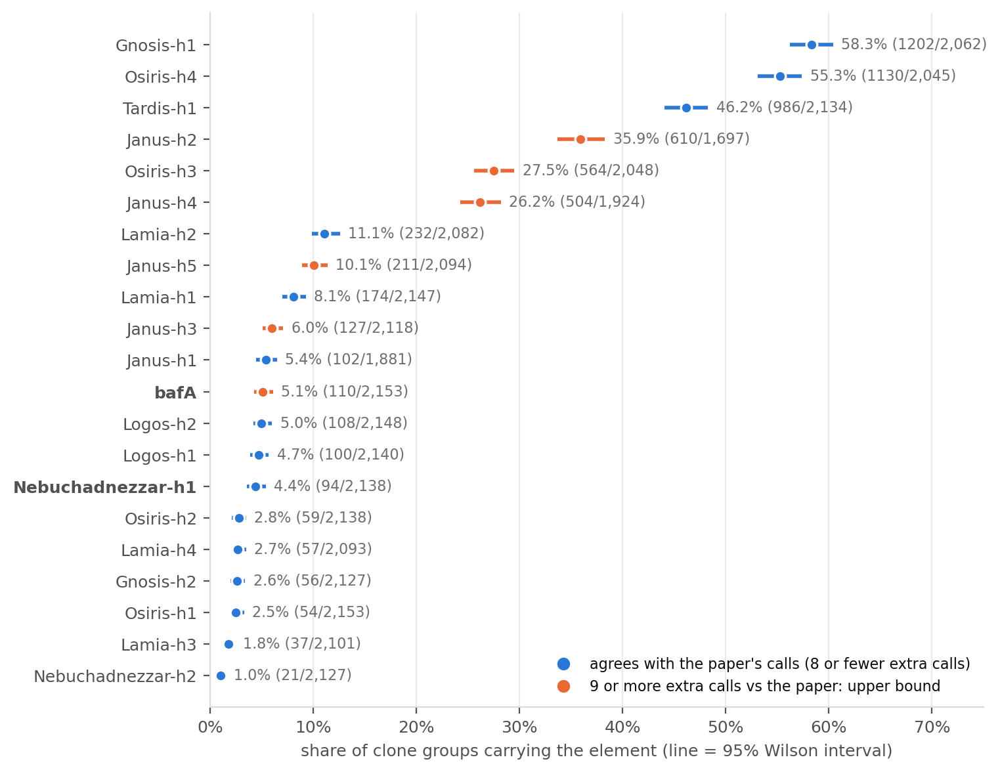
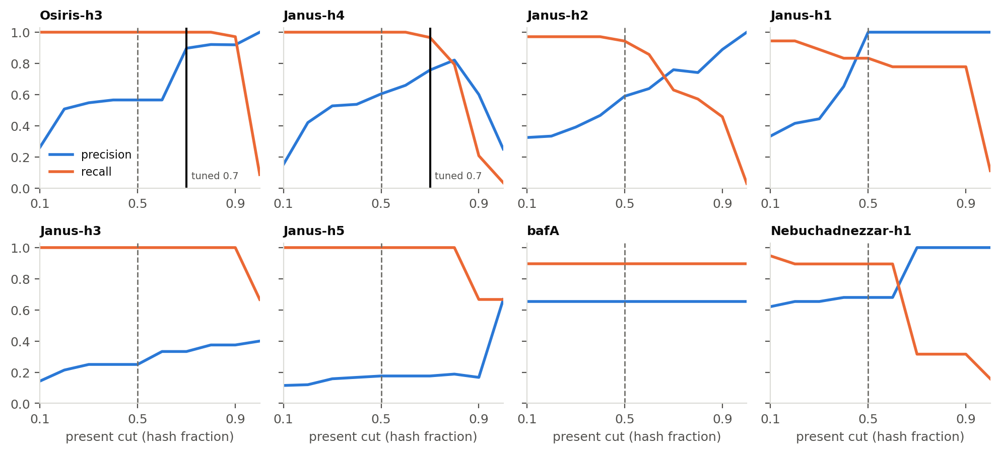
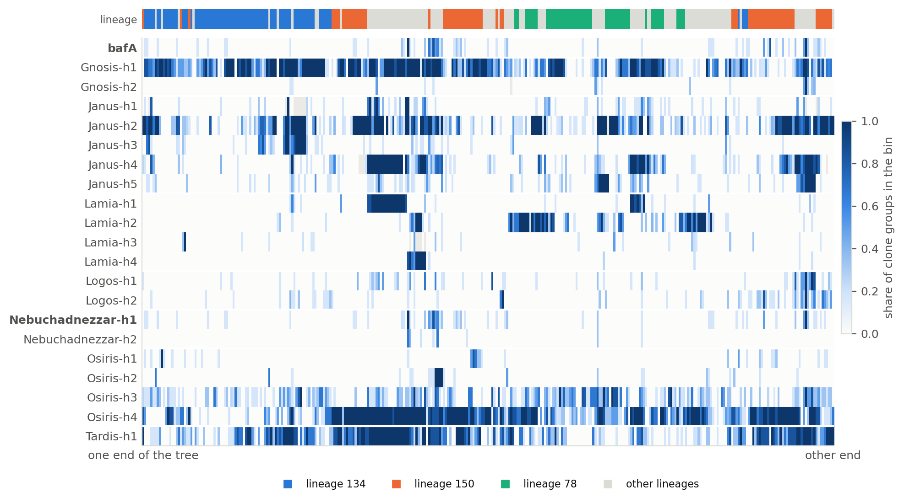
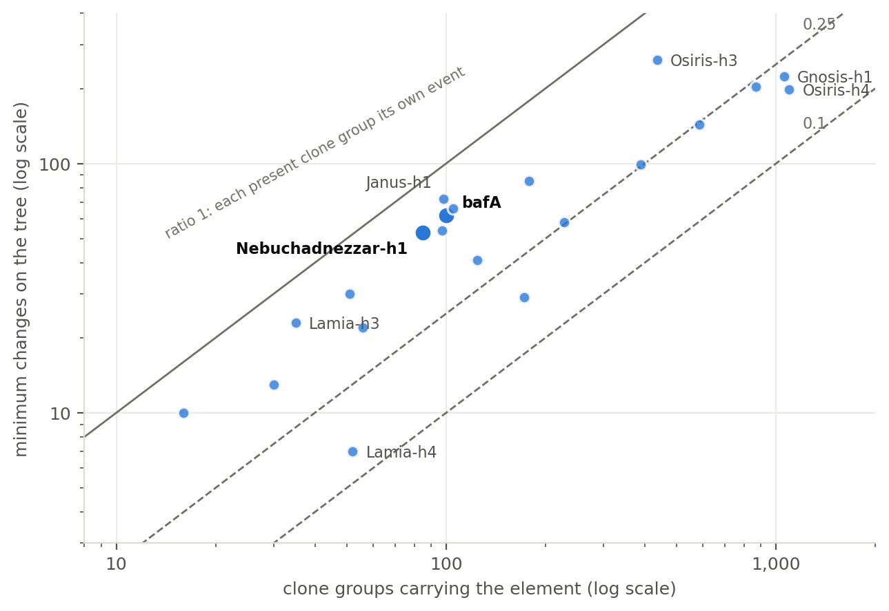
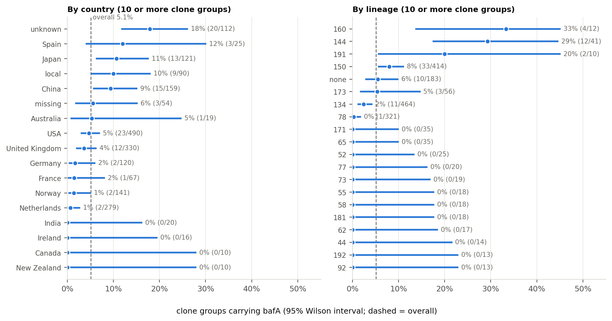
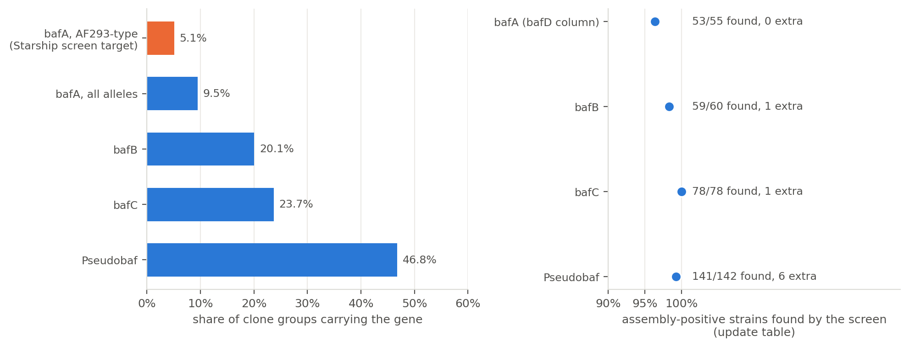
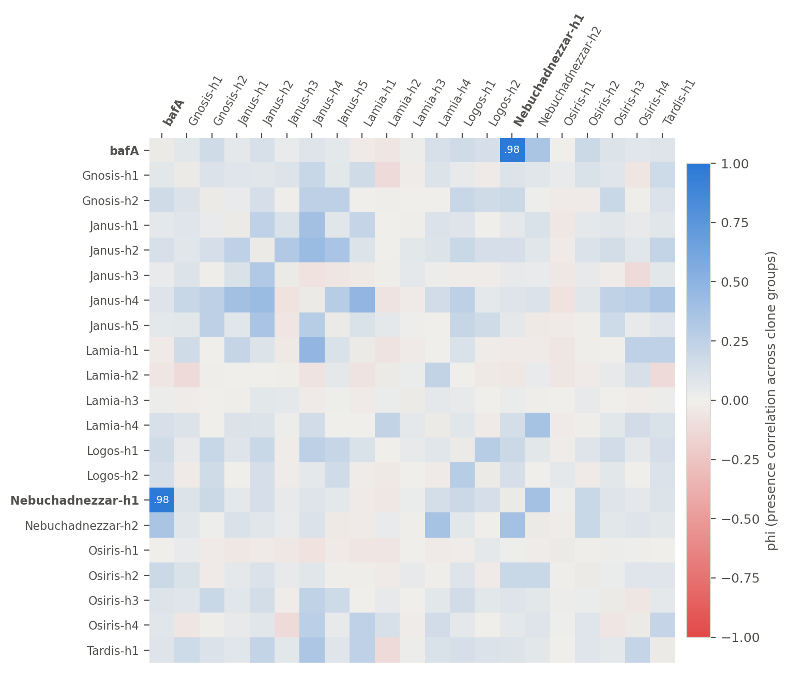

# Starships and bafA across 4,849 *Aspergillus fumigatus* isolates

Sketch-store analysis, 2026-11-11. Which isolates carry a Nebuchadnezzar-h1-type Starship with bafA, how common the other 20 defined Starship haplotypes are, and how their presence is spread over the population tree. Every figure and table names its source. An interactive version of this report exists as a private page; this file is the archived copy.

| Provenance |  |
| :--- | :--- |
| code | `5ea2d2d` on branch `baf-family` (PR #330) |
| rescreen job | `31993754` |
| default run | `31995348` |
| tuned run | `31995349` |
| store (HPCC) | `/bigdata/stajichlab/jstajich/projects/MATPredict/sketch_store/aspergillus_fumigatus` |
| results (HPCC) | `/bigdata/stajichlab/jstajich/projects/MATPredict/results/2026-11-11_afum_starship_dynamics` |

## Summary

|  |  |
| ---: | :--- |
| 4,736 | isolates kept of 4,849 sketched |
| 2,154 | clone groups (ANI 0.9995), one vote each |
| 5.1% | of clone groups carry the AF293-type bafA (110 of 2,153); 9.5% counting divergent alleles (section 8) |
| 371 | isolates in the strong bafA + Nebuchadnezzar-h1 list (95 clone groups) |

- **Solid.** The AF293-type bafA is present in 5.1% of clone groups and almost always sits with Nebuchadnezzar-h1 (94 of 97 clone groups with either one carry both).
- **Solid.** The solo-hash rule removed 782 ambiguous partial bafA calls without changing agreement with the paper (17 true positives, 2 missed).
- **Solid.** A screen of the whole baf family (one target per gene, built from assembly haplotypes) matches the assembly counts: bafA 53 of 55 assembly-positive strains found with 0 extra calls (the single AF293-type target found 41 of 55). Counting divergent alleles, bafA is in 204 of 2,154 clone groups; 212 isolates are newly called and 0 of them have Nebuchadnezzar-h1 present.
- **Caution.** AF293-type bafA presence is scattered over the tree: 62 changes for 100 present clone groups (ratio 0.62); Nebuchadnezzar-h1 behaves the same (0.62). That fits repeated gain or transfer, or a coarse tree; it does not by itself show either.
- **Caution.** Janus-h2, Janus-h4 and Osiris-h3 call more isolates than the paper does. Raising the cut for Osiris-h3 (0.5 to 0.7) removes most of the extra calls; Janus-h3, Janus-h5 and the AF293-type bafA keep theirs at every cut, with hash fraction near 1.0.
- **Open.** The cuts were picked on the same 226 truth samples (no hold-out yet). Only the 20 haplotypes of the NII pangenome study are screened; the Starbase / Gluck-Thaler set is not.

## 1. Data and method

| Step | What | Where |
| :--- | :--- | :--- |
| Read sketches | k21 and k31, scaled 100, abundance kept (>= 2), 30x subsample per isolate | `sketch_store/aspergillus_fumigatus/sigs/` |
| Clone groups | average-linkage groups at ANI 0.9995: 2,154 groups | `query/distances/samples_qc.tsv` |
| Screen | fraction of each target's specific hashes found, 21 targets (bafA + 20 haplotypes) | `query/screen_starships_bafA/screen.tsv` |
| Solo-hash rule | 18 hashes dropped that appear alone in > 1% of isolates | `dropped_hashes.tsv`, job `31993754` |
| Call | present >= 0.5, absent < 0.2, otherwise missing; clone vote = majority of its members | `starship_dynamics.py` |
| Tree | Fitch parsimony on the FastME distance tree, one tip per clone group (1,971 of 2,154 have a tip) | `query/distances/tree_fastme.nwk` |

Left out of every frequency: other species: 63, qc mixture: 49, curator exclude: 1 isolates (other species, k-mer mixtures, one curator exclusion). Partial hits (0.2 to 0.5) count as missing, never as loss.

## 2. Effect of the solo-hash rule

A hash seen alone in many isolates is shared with other sequence. "Paper" columns use the 226-sample truth table at a present cut of 0.5.

| Element | Specific hashes | Present | Partial | Paper TP | Paper FP | Paper FN |
| :--- | ---: | ---: | ---: | ---: | ---: | ---: |
| **bafA** | 3 -> 2 | 407 -> 411 | 782 -> 0 | 17 | 9 | 2 |
| Gnosis-h1 | 670 -> 669 | 2,816 | 187 | 141 | 4 | 0 |
| Tardis-h1 | 899 | 2,329 | 31 | 91 | 1 | 1 |
| Osiris-h4 | 517 | 2,538 | 131 | 113 | 0 | 0 |
| Osiris-h3 | 604 -> 603 | 1,320 -> 1,319 | 241 -> 217 | 35 | 27 | 0 |
| Janus-h4 | 36 -> 35 | 1,314 -> 1,309 | 333 -> 466 | 29 | 19 | 0 |
| Lamia-h1 | 748 | 447 | 14 | 6 | 0 | 1 |
| Janus-h2 | 3,049 | 1,431 | 1,031 | 33 | 23 | 2 |
| Logos-h1 | 487 -> 484 | 441 | 8 | 15 | 2 | 1 |
| Janus-h1 | 544 -> 543 | 254 | 878 | 15 | 0 | 3 |
| Logos-h2 | 577 | 414 | 10 | 10 | 1 | 0 |
| Janus-h5 | 50 -> 48 | 634 -> 635 | 107 -> 104 | 3 | 14 | 0 |
| **Nebuchadnezzar-h1** | 377 -> 375 | 379 | 29 | 17 | 8 | 2 |
| Janus-h3 | 56 -> 54 | 261 | 152 -> 150 | 3 | 9 | 0 |
| Gnosis-h2 | 834 -> 833 | 243 | 38 | 5 | 1 | 0 |
| Lamia-h4 | 1,012 | 147 | 84 | 5 | 0 | 2 |
| Osiris-h2 | 1,288 -> 1,286 | 114 | 29 | 10 | 0 | 1 |
| Lamia-h2 | 124 -> 123 | 551 -> 535 | 154 -> 169 | 7 | 2 | 0 |
| Osiris-h1 | 381 | 111 | 4 | 6 | 0 | 0 |
| Lamia-h3 | 960 | 70 | 120 | 2 | 2 | 0 |
| Nebuchadnezzar-h2 | 393 | 60 | 43 | 7 | 0 | 0 |

The rule only helps where the extra hash was a single non-specific one: bafA partials fall from 782 to 0. False positives for Janus and Osiris-h3 do not fall, because their overcall comes from hashes shared across the family.

Source: `tables/rescreen_before_after.tsv`; `query_2026-11-09_n4834/screen_starships_bafA_before_solo_rule/summary.txt` and `query/screen_starships_bafA/summary.txt`, job `31993754`.

## 3. How common is each element

*Figure: Share of clone groups carrying each element. Click the image for the vector PDF.*

One point is one clone group, so a study that sequenced one lineage fifty times counts once. Orange rows are upper bounds only. In this and the following sections `bafA` is the AF293-type allele (the 2-hash genomic target of the Starship screen); section 8 counts all bafA alleles.

| Element | Clone groups present / typed | Share | 95% CI | Isolates present | Paper TP / FP / FN |
| :--- | ---: | ---: | ---: | ---: | ---: |
| Gnosis-h1 | 1202 / 2,062 | 58.3% | 56.2% to 60.4% | 2,783 | 141 / 4 / 0 |
| Osiris-h4 | 1130 / 2,045 | 55.3% | 53.1% to 57.4% | 2,513 | 113 / 0 / 0 |
| Tardis-h1 | 986 / 2,134 | 46.2% | 44.1% to 48.3% | 2,311 | 91 / 1 / 1 |
| Janus-h2 | 610 / 1,697 | 35.9% | 33.7% to 38.3% | 1,424 | 33 / 23 / 2 |
| Osiris-h3 | 564 / 2,048 | 27.5% | 25.6% to 29.5% | 1,311 | 35 / 27 / 0 |
| Janus-h4 | 504 / 1,924 | 26.2% | 24.3% to 28.2% | 1,303 | 29 / 19 / 0 |
| Lamia-h2 | 232 / 2,082 | 11.1% | 9.9% to 12.6% | 535 | 7 / 2 / 0 |
| Janus-h5 | 211 / 2,094 | 10.1% | 8.9% to 11.4% | 633 | 3 / 14 / 0 |
| Lamia-h1 | 174 / 2,147 | 8.1% | 7.0% to 9.3% | 446 | 6 / 0 / 1 |
| Janus-h3 | 127 / 2,118 | 6.0% | 5.1% to 7.1% | 259 | 3 / 9 / 0 |
| Janus-h1 | 102 / 1,881 | 5.4% | 4.5% to 6.5% | 250 | 15 / 0 / 3 |
| **bafA** | 110 / 2,153 | 5.1% | 4.3% to 6.1% | 405 | 17 / 9 / 2 |
| Logos-h2 | 108 / 2,148 | 5.0% | 4.2% to 6.0% | 407 | 10 / 1 / 0 |
| Logos-h1 | 100 / 2,140 | 4.7% | 3.9% to 5.7% | 437 | 15 / 2 / 1 |
| **Nebuchadnezzar-h1** | 94 / 2,138 | 4.4% | 3.6% to 5.4% | 374 | 17 / 8 / 2 |
| Osiris-h2 | 59 / 2,138 | 2.8% | 2.1% to 3.5% | 113 | 10 / 0 / 1 |
| Lamia-h4 | 57 / 2,093 | 2.7% | 2.1% to 3.5% | 147 | 5 / 0 / 2 |
| Gnosis-h2 | 56 / 2,127 | 2.6% | 2.0% to 3.4% | 242 | 5 / 1 / 0 |
| Osiris-h1 | 54 / 2,153 | 2.5% | 1.9% to 3.3% | 110 | 6 / 0 / 0 |
| Lamia-h3 | 37 / 2,101 | 1.8% | 1.3% to 2.4% | 70 | 2 / 2 / 0 |
| Nebuchadnezzar-h2 | 21 / 2,127 | 1.0% | 0.6% to 1.5% | 60 | 7 / 0 / 0 |

Source: `tables/prevalence.tsv` (`out_default/prevalence.tsv`); agreement from `targets/truth_store.tsv`.

## 4. Agreement with the paper

*Figure: Precision and recall against the paper's calls by present cut. Click the image for the vector PDF.*

| Element | Cut | False pos. at 0.5 | False pos. at cut | True pos. at 0.5 | True pos. at cut |
| :--- | ---: | ---: | ---: | ---: | ---: |
| Osiris-h3 | 0.7 | 27 | 4 | 35 | 35 |
| Janus-h4 | 0.7 | 19 | 9 | 29 | 28 |

Elements with only a handful of paper positives (Janus-h3, Janus-h5) cannot be tuned. For bafA and Janus-h3/h5 the extra calls have hash fraction near 1.0 and normal depth, so they look genuinely present; the paper's calls may be incomplete there (for bafA the paper table is mostly a Nebuchadnezzar-h1 proxy). The cuts for Osiris-h3 and Janus-h4 were read off this same truth table, so their gain is optimistic until tested on strains not used to choose them.

Source: `tables/threshold_sweep.tsv` (`out_default/threshold_sweep.tsv`, truth `targets/truth_store.tsv`, 226 samples).

## 5. Spread over the population tree

*Figure: Share of clone groups carrying each element along the tree. Click the image for the vector PDF.*

The 1,971 clone groups with a tip in the tree are laid out in tree order and pooled 6 per column. A solid band means the element sits in one part of the tree; speckle means it appears here and there. The strip shows the dominant lineage per column (lineage = group at ANI 0.998). 183 clone groups have no tip in the tree and are not shown; fine order inside a lineage is not reliable.

Source: `out_default/clone_matrix.tsv` and `tree_order.tsv`; tree `query/distances/tree_fastme.nwk`.

## 6. Gains and losses on the tree

*Figure: Minimum changes on the tree against clone groups present. Click the image for the vector PDF.*

| Element | Present clones | Min. changes | Changes / present | Gains | Losses | Prevalence |
| :--- | ---: | ---: | ---: | ---: | ---: | ---: |
| Janus-h1 | 98 | 72 | 0.73 | 64 | 8 | 5.4% |
| Lamia-h3 | 35 | 23 | 0.66 | 21 | 2 | 1.8% |
| Logos-h2 | 105 | 66 | 0.63 | 55 | 11 | 5.0% |
| **bafA** | 100 | 62 | 0.62 | 55 | 7 | 5.1% |
| **Nebuchadnezzar-h1** | 85 | 53 | 0.62 | 47 | 6 | 4.4% |
| Nebuchadnezzar-h2 | 16 | 10 | 0.62 | 8 | 2 | 1.0% |
| Osiris-h3 | 436 | 260 | 0.6 | 202 | 58 | 27.5% |
| Osiris-h1 | 51 | 30 | 0.59 | 26 | 4 | 2.5% |
| Logos-h1 | 97 | 54 | 0.56 | 50 | 4 | 4.7% |
| Janus-h5 | 178 | 85 | 0.48 | 70 | 15 | 10.1% |
| Gnosis-h2 | 30 | 13 | 0.43 | 12 | 1 | 2.6% |
| Osiris-h2 | 56 | 22 | 0.39 | 21 | 1 | 2.8% |
| Janus-h3 | 124 | 41 | 0.33 | 31 | 10 | 6.0% |
| Janus-h4 | 388 | 99 | 0.26 | 65 | 34 | 26.2% |
| Lamia-h2 | 228 | 58 | 0.25 | 37 | 21 | 11.1% |
| Janus-h2 | 585 | 143 | 0.24 | 103 | 40 | 35.9% |
| Tardis-h1 | 869 | 203 | 0.23 | 111 | 92 | 46.2% |
| Gnosis-h1 | 1,057 | 224 | 0.21 | 124 | 100 | 58.3% |
| Osiris-h4 | 1,097 | 198 | 0.18 | 100 | 98 | 55.3% |
| Lamia-h1 | 172 | 29 | 0.17 | 21 | 8 | 8.1% |
| Lamia-h4 | 52 | 7 | 0.13 | 6 | 1 | 2.7% |

Fitch parsimony on the distance tree, one tip per clone group; the root state is fixed by the data, so root-present gives the same split. Read the counts as a pattern: multifurcations are resolved left to right, and overcalled elements are inflated.

Source: `tables/parsimony.tsv`; method in the `starship_dynamics.py` docstring, tested against a Sankoff dynamic program on 200 random trees.

## 7. bafA and Nebuchadnezzar-h1

*Figure: bafA by country and by lineage. Click the image for the vector PDF.*

|  | Neb-h1 present | Neb-h1 absent |
| :--- | ---: | ---: |
| bafA present | 94 | 3 |
| bafA absent | 0 | 2041 |

`bafA` here is the AF293-type allele; divergent alleles are in section 8. 2,138 clone groups are typed for both. Country and lineage are confounded (sampling is uneven; lineage 150 contributes many bafA-positive clone groups), so differences are descriptive, not tests.

Source: `tables/prevalence_by_country.tsv`, `tables/prevalence_by_lineage.tsv`, `out_default/clone_matrix.tsv`.

## 8. bafA beyond the AF293-type allele (baf family)

The Starship screen's bafA target is the AF293-type genomic copy and has 2 usable hashes, so a divergent allele can be invisible to it. Assembly counts for the baf genes (`/bigdata/stajichlab/shared/projects/A_fumigatus/baf/strain_gene_counts*.tab`; the `bafD` column is bafA, 96% of its 21-mers) show this, so the family was screened with one target per gene, built from the assembly hit sequences (12 bafA, 6 bafB, 36 bafC and 67 Pseudobaf haplotypes, joined with N gaps). Gene presence = hit count at or above a cut (2 specific hashes for bafA, bafC and Pseudobaf; bafB has a single specific hash, so 1). The gene family is described in Kowalski et al. 2021, [mBio 12(1)](https://doi.org/10.1128/mBio.03579-20).

*Figure: baf family prevalence by clone group, and strains with an assembly copy that the screen finds. Click the image for the vector PDF.*

Agreement with the assembly counts (strains in the store that are not flagged):

| Counts table | Gene | Cut (hits) | Assembly-positive found | Extra calls | Recall |
| :--- | :--- | ---: | ---: | ---: | ---: |
| strain_gene_counts.tab | bafA | 2 | 42 / 43 | 2 | 98% |
| strain_gene_counts.tab | bafB | 1 | 49 / 50 | 0 | 98% |
| strain_gene_counts.tab | bafC | 2 | 69 / 69 | 0 | 100% |
| strain_gene_counts.tab | Pseudobaf | 2 | 106 / 107 | 3 | 99% |
| strain_gene_counts.tab | bafA, single AF293-type target (before) |  | 35 / 43 | 0 | 81% |
| strain_gene_counts_update.tab | bafA | 2 | 53 / 55 | 0 | 96% |
| strain_gene_counts_update.tab | bafB | 1 | 59 / 60 | 1 | 98% |
| strain_gene_counts_update.tab | bafC | 2 | 78 / 78 | 1 | 100% |
| strain_gene_counts_update.tab | Pseudobaf | 2 | 141 / 142 | 6 | 99% |
| strain_gene_counts_update.tab | bafA, single AF293-type target (before) |  | 41 / 55 | 0 | 75% |

The extra bafA calls against the older table are strains the newer table lists as carrying bafA. The bafA misses are IFM_59359 (its read sets and assembly disagree, see the earlier mixup) and one more strain that is not explained yet. Relative depth separates 2-copy from 1-copy strains only weakly, so it is not a copy-number estimate.

Across the 4,736 kept isolates:

| Gene | Cut (hits) | Isolates | Share | Clone groups | Share |
| :--- | ---: | ---: | ---: | ---: | ---: |
| bafA, AF293-type (Starship screen) |  | 405 | 8.6% | 110 of 2,153 | 5.1% |
| bafA, all alleles | 2 | 605 | 12.8% | 204 of 2,154 | 9.5% |
| bafB | 1 | 1,160 | 24.5% | 432 of 2,154 | 20.1% |
| bafC | 2 | 1,168 | 24.7% | 511 of 2,154 | 23.7% |
| Pseudobaf | 2 | 2,336 | 49.3% | 1008 of 2,154 | 46.8% |

**Two classes of bafA.** The AF293-type target sits in the hrmA cluster (next to hrmA and cgnA), so a call by that target is called *cluster-linked*. A call made only by the all-alleles screen is called *standalone divergent*:

| Class | Isolates | Clone groups | Nebuchadnezzar-h1 present | Nebuchadnezzar-h1 absent |
| :--- | ---: | ---: | ---: | ---: |
| cluster-linked (AF293-type target present) | 405 | 110 of 2,154 (5.1%) | 373 | 32 |
| standalone divergent (all-alleles screen only) | 212 | 100 of 2,154 (4.6%) | 0 | 212 |

Cluster-linked is **not the same as** Nebuchadnezzar-h1: 373 of 405 cluster-linked isolates have Nebuchadnezzar-h1 present and 32 do not, and 2 isolates have Nebuchadnezzar-h1 without any bafA. The two travel together, which fits the hrmA cluster being on that Starship, but this is a co-occurrence in sketches, not a placement in genomes.

**Check in assemblies** (blastn of the bafA haplotypes, hrmA and cgnA; only strains with an assembly in the shared baf folder): the 12 standalone divergent isolates with an assembly all have a bafA copy (12 of 12) and 0 have hrmA or cgnA anywhere in the genome, so the copy is not in the hrmA cluster. Of 40 cluster-linked isolates with an assembly, 38 have the bafA copy, all of those have hrmA/cgnA, and 37 have it within about 1.1 kb of them on one contig. Only 12 of the 212 standalone isolates have an assembly, so the other 200 are inferred from the sketch. The locus of the standalone copies is not mapped yet.

Isolates: the AF293-type target and the all-alleles call agree on 393 present and 4,119 absent; 212 are called only by the all-alleles screen and 12 only by the old target (one hash in common). Against Nebuchadnezzar-h1: 372 isolates have both, 233 have bafA without Nebuchadnezzar-h1, 2 have Nebuchadnezzar-h1 without bafA. None of the 212 newly called isolates has Nebuchadnezzar-h1 present, so these are bafA copies that are not on that Starship. The strong candidate list in section 10 uses the cluster-linked call and is unchanged.

Source: `tables/baf_family_summary.json` (`baf_family.py summarize`), screen `query/screen_baf_family/` in the store (job `31996411`, `--max-solo 0`), counts from the shared folder above. The strain-level comparison names local strains and stays in the results folder.

## 9. Which elements travel together

*Figure: Pairwise phi of presence across clone groups. Click the image for the vector PDF.*

Strongest pairs from different families:

| Element 1 | Element 2 | Clone groups typed | Both | Only 1 | Only 2 | Neither | phi |
| :--- | ---: | ---: | ---: | ---: | ---: | ---: | ---: |
| bafA | Nebuchadnezzar-h1 | 2,138 | 94 | 3 | 0 | 2,041 | 0.98 |
| Janus-h4 | Lamia-h1 | 1,918 | 157 | 343 | 13 | 1,405 | 0.47 |
| Lamia-h4 | Nebuchadnezzar-h2 | 2,068 | 11 | 31 | 10 | 2,016 | 0.36 |
| bafA | Nebuchadnezzar-h2 | 2,126 | 17 | 91 | 4 | 2,014 | 0.34 |
| Tardis-h1 | Janus-h4 | 1,908 | 366 | 489 | 135 | 918 | 0.34 |
| Osiris-h4 | Janus-h4 | 1,824 | 328 | 670 | 88 | 738 | 0.26 |
| Janus-h4 | Logos-h1 | 1,915 | 67 | 432 | 19 | 1,397 | 0.26 |
| Janus-h4 | Gnosis-h2 | 1,901 | 51 | 449 | 5 | 1,396 | 0.26 |
| Janus-h5 | Gnosis-h2 | 2,069 | 31 | 173 | 25 | 1,840 | 0.26 |
| Tardis-h1 | Lamia-h1 | 2,129 | 152 | 831 | 21 | 1,125 | 0.25 |

Elements from the same family look correlated because they share sequence. Phi has no significance test here; treat strong pairs as leads.

Source: `tables/cooccurrence.tsv`.

## 10. The strains

| Tier | All | After flagged removed | Public | Local |
| :--- | ---: | ---: | ---: | ---: |
| strong | 376 | 371 | 311 | 65 |
| probable | 29 | 29 | 25 | 4 |
| discordant | 7 | 6 | 6 | 1 |

**strong** = both bafA hashes found and Nebuchadnezzar-h1 present. **probable** = bafA present and Nebuchadnezzar-h1 partial. **discordant** = one of the two present without the other (check read depth before counting these). Flagged = other species, k-mer mixture or curator exclusion.

Local (Population_Genomics) isolates count in these numbers but are not listed by name, as in the site report. The public isolates are in [`tables/candidates_public.tsv`](tables/candidates_public.tsv).

Strong public candidates by study (top 15):

| Study | Country | Isolates |
| :--- | :--- | ---: |
| PRJNA1335234 | unknown | 72 |
| PRJEB81974 | United Kingdom | 28 |
| PRJEB63143 | United Kingdom | 17 |
| PRJNA1347423 | unknown | 12 |
| PRJNA780348 | France | 11 |
| PRJNA632561 | USA | 11 |
| PRJNA1094460 | Israel | 11 |
| PRJEB63143 | USA | 10 |
| PRJNA1345449 | China | 10 |
| PRJNA1206311 | China | 10 |
| PRJNA961646 | China | 9 |
| PRJEB1497 | unknown | 8 |
| PRJNA1448995 | unknown | 7 |
| PRJNA638646 | Japan | 7 |
| PRJDB3064 | Japan | 7 |

Source: `tables/candidates_public.tsv` (from `bafA_neb_h1_candidates_v2.tsv`, public rows only).

## 11. Sensitivity to the cuts

| Element | Clones present (default) | Share | Clones present (tuned) | Share | Changes / present (default) | Changes / present (tuned) |
| :--- | ---: | ---: | ---: | ---: | ---: | ---: |
| Osiris-h3 | 564 / 2,048 | 27.5% | 427 / 1,911 | 22.3% | 0.6 | 0.6 |
| Janus-h4 | 504 / 1,924 | 26.2% | 403 / 1,825 | 22.1% | 0.26 | 0.23 |

The cut moves the prevalence by a few points. The scatter ratio hardly changes, so the conclusion that Osiris-h3 is scattered and Janus-h4 is clade-structured does not depend on it. bafA, Nebuchadnezzar-h1 and every other element are unaffected.

## 12. Limits

- The 20 haplotypes are those of the NII *A. fumigatus* pangenome study (Table S21). Starbase and the Gluck-Thaler set are not screened.
- Presence means most of an element's specific 21-mers are in the read sketch at 30x depth. It does not give an insertion site, an intact element, or copy number.
- The paper table used as truth covers 226 isolates, and for bafA it is mostly a Nebuchadnezzar-h1 proxy. Agreement is a check, not proof.
- Cuts for Osiris-h3 and Janus-h4 were chosen on the same truth table. They need a hold-out check.
- Gain/loss counts come from a sketch distance tree with 1,971 of 2,154 clone groups. They describe a pattern.

## 13. Traceability and regeneration

| What | File or job | Made by |
| :--- | :--- | :--- |
| Sketches, QC, clone groups, tree | `/bigdata/stajichlab/jstajich/projects/MATPredict/sketch_store/aspergillus_fumigatus/{sigs,query}` | store build (PR #315), queries job 31975386 |
| Starship screen (21 targets) | `query/screen_starships_bafA/` | rescreen job `31993754` |
| Prevalence, matrix, parsimony, co-occurrence, sweep | `/bigdata/stajichlab/jstajich/projects/MATPredict/results/2026-11-11_afum_starship_dynamics/out_default/` | `starship_dynamics.py` at `5ea2d2d`, job `31995348` |
| Tuned cuts | `/bigdata/stajichlab/jstajich/projects/MATPredict/results/2026-11-11_afum_starship_dynamics/out_tuned/` | `--set Osiris-h3=0.7 Janus-h4=0.7`, job `31995349` |
| Report data | `/bigdata/stajichlab/jstajich/projects/MATPredict/results/2026-11-11_afum_starship_dynamics/report_data.json` | `starship_report_data.py` at `5ea2d2d` |
| baf family screen | `query/screen_baf_family/`, `tables/baf_family_summary.json` | `baf_family.py` (targets, summarize), job `31996411` |
| This file, figures, tables | `report.md`, `figures/`, `tables/` | `starship_report_md.py` |

Regenerate on the HPCC, from the results folder: `sbatch run_dynamics.sh; sbatch run_tuned.sh; sbatch run_report.sh` (runs both the page and this markdown). Tests: `pixi run -e test python -m pytest tests -k sketch_store`.

