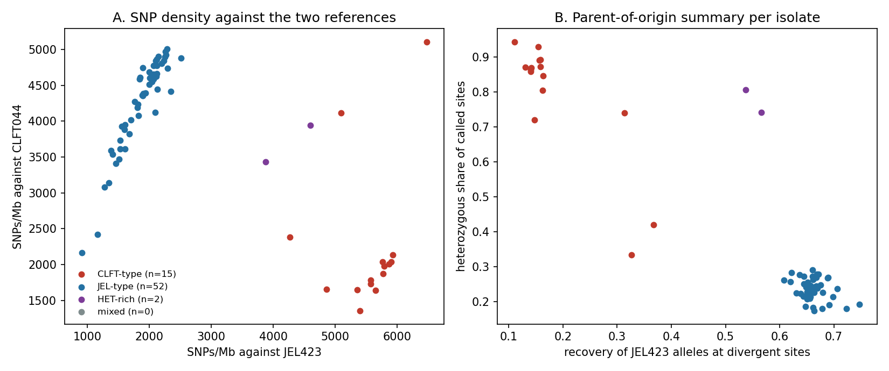

# Batrachochytrium dendrobatidis: read depth, heterozygosity and parent of origin

Status: exploratory analysis of public reads. Nothing here is curated or accepted. Bd isolates are diploid, and the
allele balance is read that way.

Pipeline commit: `6bfc6a3cad`. Jobs: JEL423 reference 32070127 and 32070630 (array 2-9); CLFT044 reference 32070128 and
32070631; reference alignment 32089404 (minimap2 2.30, `-x asm10 -c --cs=short`). Result folder on the HPCC:
`results/2026-11-13_bd_coverage/` (not committed; tables below are copies).

## Data

- Runs: 69 runs analysed of 72 listed (Brazil 52, other countries 17), chosen from PopSeq
  `catalog/runs/fungi_all_runs.csv.gz` (ENA snapshot 2026-11-06) and ENA. All were Illumina WGS. See `tables/bd_runs_popseq.tsv`.
- References: JEL423 (GCA_048537975.1) and UCR_BdCLFT044 (Brazil lineage per the curator). I did not verify the lineage of JEL423 here.
- Each run: `prefetch`, `fasterq-dump`, read-pair count checked against ENA `read_count`, `bwa-mem2`, duplicate removal,
  `mosdepth` 10 kb windows (MAPQ 20), `bcftools` SNP calls (QUAL 30).
- Excluded runs (`tables/excluded_runs.tsv`):
  - SRR13660529: mate2 7132682 vs ena 29477484
  - ERR14883802: mates 4218822 each; ena 8437644 (= 2x mate count)

## 1. Depth and SNP density

Median depth of the 69 isolates: 32.9x (range
10.8 to 178.6). 10 isolates have median depth below 20x; treat their numbers with more care.

Isolates against their own reference (controls):

| control | SNPs/Mb vs JEL423 | het fraction | SNPs/Mb vs CLFT044 | het fraction |
|---|---|---|---|---|
| CLFT044 reads | 5399.1 | 0.4391 | 1356.8 | 0.9345 |
| JEL423 reads | 1851.2 | 0.9264 | 4611.6 | 0.4079 |

An isolate does not give near-zero SNPs against its own reference. Each reference is a haploid representation of a diploid
genome, so heterozygous sites are expected, and the het fraction is high (0.9). Repeats and paralogs can add het-like SNPs;
I did not separate the two causes. A het fraction alone therefore cannot call a hybrid.

Depth flags: sequences of 200 kb or more with median depth outside 0.75 to 1.25 of the genome median occur in most isolates (0 to 11 per isolate)
(see `tables/bd_isolate_summary_*.tsv`, column `depth_flag_seqs`). I did not separate copy-number change from repeat or
assembly artefacts. Ploidy variation, including aneuploidy, is also known in Bd; I did not test it here.

 [PDF](figures/bd_summary.pdf)

Figure source: `tables/isolate_classes.tsv`, `tables/parent_origin_summary.tsv`; script `scripts/bd_report.py`.

## 2. Parent of origin

Method (`scripts/bd_parent_of_origin.py`): align JEL423 to CLFT044 and take single-base differences in primary alignments
(172,706 sites). In each isolate, a site is "called" when its CLFT044-reference SNP table has the JEL423 base. Per 50 kb
window: recovery = called sites / usable sites; het share = called sites with alt fraction 0.2 to 0.8. A window is `CLFT`
when recovery < 0.5, else `HET` when het share >= 0.5, else `JELHOM`.

Why sites without a SNP row are not counted as CLFT044 allele: in the JEL423 isolate about a third of divergent sites have no row,
so absence is not evidence. I first counted them as CLFT044 and the JEL423 isolate then scored only 0.57 JEL fraction; that
version was dropped.

Calibration: only two controls. In the CLFT044 isolate the window recovery has median 0.05 and 95th percentile 0.41. In the
JEL423 isolate the median is 0.87 and the 5th percentile 0.16. I set the cutoff at 0.5 from these. It is not validated on isolates
of known hybrid status. Isolate class: CLFT-type if over 60% CLFT windows, JEL-type if over 60% JELHOM windows, HET-rich if
over 50% HET windows, else mixed.

| group | CLFT-type | JEL-type | HET-rich | mixed |
|---|---|---|---|---|
| Brazil (n=52) | 13 | 37 | 2 | 0 |
| Other countries (n=17) | 2 | 15 | 0 | 0 |

Control isolates: CLFT044 is CLFT-type; JEL423 is JEL-type.

### Isolates that are HET-rich or mixed

| isolate | country | median depth | SNPs/Mb vs JEL423 | SNPs/Mb vs CLFT044 | recovery | het share of called | windows CLFT/HET/JELHOM | class |
|---|---|---|---|---|---|---|---|---|
| CLFT160 | Brazil | 27.5 | 4593.9 | 3939.5 | 0.5369 | 0.8059 | 152/277/28 | HET-rich |
| CLFT039 | Brazil | 16.2 | 3874.4 | 3429.5 | 0.5664 | 0.7422 | 102/292/38 | HET-rich |

These isolates carry JEL423 alleles in most windows, mostly in one copy. That is the pattern expected for a first-generation
hybrid of the two lineages. It does not show that they are hybrids. Other explanations I did not exclude: a third lineage that shares
alleles with both references; aneuploidy; mapping effects at divergent sites. A hybrid call needs a tree or ancestry analysis and
a lineage reference beyond these two. Published context: a Bd-GPL x Bd-Brazil hybrid zone in the Serra da Graciosa, Parana (Jenkinson et al. 2016,
doi 10.1111/mec.13599). I did not compare my isolates with that study's samples.

### Non-Brazil isolates that are CLFT-type

| isolate | country | median depth | SNPs/Mb vs JEL423 | SNPs/Mb vs CLFT044 | recovery | het share of called | windows CLFT/HET/JELHOM | class |
|---|---|---|---|---|---|---|---|---|
| KRBOOR_331 | South Korea | 175.0 | 6472.1 | 5103.9 | 0.3672 | 0.4199 | 350/8/122 | CLFT-type |
| Generic sample from B. dendrobatis | Switzerland: Gamlikon | 86.2 | 5091.5 | 4115.0 | 0.3267 | 0.3347 | 377/1/95 | CLFT-type |

Their recovery is 0.33 and 0.37, well below the JEL-type isolates (about 0.6 to 0.75). They carry few alleles of either reference.
A third lineage is a possible reason; I did not check their lineage.

## Limits

- Two references only. Lineage names are the curator's for CLFT044 and my understanding for JEL423.
- SNP tables keep QUAL >= 30 and no per-site depth was stored, so absence of a call cannot be told from no coverage.
- Window class is noisy: the CLFT044 control has windows with recovery up to 0.6.
- The Brazil set is 52 runs; PopSeq lists 58 Brazilian isolates, so the set is not all of them.

## Next

Add an ancestry or tree analysis with at least one more lineage reference (for example a BdASIA or BdCAPE assembly), and test
the HET-rich isolates for aneuploidy with allele balance by sequence.
